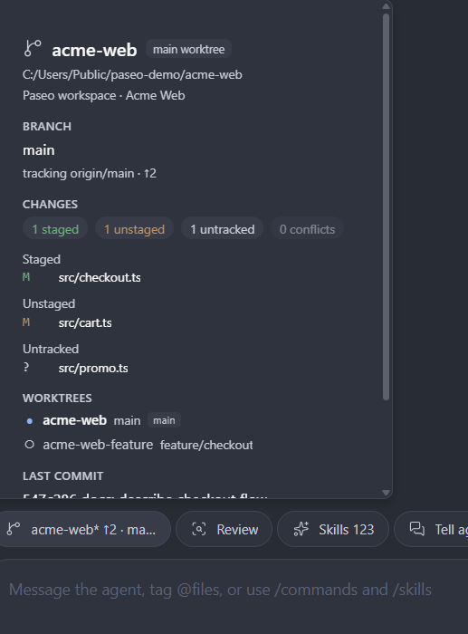

# paseo-git-status

A [Paseo](https://paseo.sh) plugin that puts the current git status in the composer, beside Tasks, Subagents, and the other composer pills.

The pill is registered per agent, so it answers the question that matters while a conversation is open: which worktree and branch is this session working in?



- The label names the git worktree first, then the branch. `*` means uncommitted changes, `!` means conflicts, and `↑n↓m` shows divergence from the upstream.
- The pill follows the live session. Paseo records an agent's cwd when it is created, so after a Claude agent enters or leaves a worktree with `EnterWorktree` / `ExitWorktree` the plugin reads the current directory from the agent's session transcript. When that differs from Paseo's record, the popover shows both.
- Non-git workspaces hide the pill.
- The popover shows the current worktree path and whether it is the main or a linked worktree, every worktree in the repository, branch and upstream state, staged/unstaged/untracked/conflicted files, the last commit, the stash count, and any merge, rebase, cherry-pick, revert, or bisect in progress.
- Click a worktree row to ask the agent to switch: **Enter** for a linked worktree, **Exit** to return to the main one. The plugin sends a normal user message, so the switch is visible in the conversation and costs one turn; it needs a second click to confirm and is offered only for an idle Claude agent.
- Long worktree and branch names never have to stay truncated: hover or tap the name part of a worktree row to reveal its full absolute path and branch, selectable for copying. The pill's title also carries the untruncated `worktree · branch — path`, so hosts that render button titles as tooltips show it on hover and screen readers always get the full identity.
- Status is polled every five seconds while the composer is visible and every three seconds while the popover is open. The plugin only reads git state; it never runs git write operations and makes no network requests. The one message it can send is the worktree switch you confirm.

## Requirements

- Paseo 0.11.4 or later on the daemon and on the client (desktop, web, or mobile).
- `git` available on the daemon's `PATH`.

## Install

Install directly from this repository:

```bash
paseo plugin add git:zzeitt/paseo-git-status
```

Pin a revision with `--ref`, and target another daemon with `--host`:

```bash
paseo plugin add git:zzeitt/paseo-git-status --ref v0.1.0 --host <host>
```

If HTTPS access to GitHub is blocked, or the daemon host routes Git HTTPS through an unavailable proxy, install from the SSH URL instead:

```bash
paseo plugin add git@github.com:zzeitt/paseo-git-status.git
```

SSH requires a GitHub SSH key on the daemon host.

Then reload the app if the composer does not show the pill immediately.

## Development

```bash
npm install
npm run typecheck
npm test
```

To try a local checkout in the daemon on this machine:

```bash
paseo plugin install /absolute/path/to/paseo-git-status
paseo plugin reload paseo-git-status
```

The plugin entry points are `index.client.tsx` and `index.server.ts`. The daemon-side RPC is `gitstatus.get` in `shared/git-status.ts`; it runs `git worktree list --porcelain`, `git status --porcelain=v2 --branch -z`, `git log -1`, and `git stash list` in the agent's working directory, falling back to its workspace directory when no agent cwd is available. When the request carries an `agentId`, the daemon also resolves the live directory from that agent's Claude session transcript (`server/live-cwd.ts`).

## License

MIT
